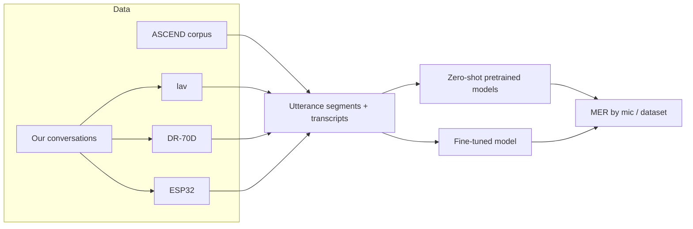

# CodeSwitch-ASR

**Fine-tuning speech recognition for Mandarin-English code-switched conversation --
and how much the microphone matters.**
COMP 395 (Deep Learning) final project, Occidental College, Fall 2026.

> Status: Week 1 -- project scaffold. Sections marked TODO are filled in as the project progresses.

## Project summary

TODO (final version after results). Working description: off-the-shelf ASR models often
fail on conversational speech that mixes Mandarin and English within a sentence. We
evaluate several pretrained models on the public ASCEND corpus and on our own recorded
conversations among international students, fine-tune a pretrained model, and measure
how recognition changes across three microphone types recording the same conversations:
close-talk lavalier mics, a far-field field recorder, and low-cost ESP32 boards.

## Research questions

1. How much does fine-tuning reduce mixed error rate (MER) on code-switched speech,
   compared with zero-shot pretrained models?
2. Does adding a small amount of in-domain data (our recordings) help beyond a public
   code-switching corpus?
3. How does MER change from close-talk to far-field to low-cost microphones, and does
   fine-tuning close that gap?

## Codebase map

| Path | Purpose |
|---|---|
| `pyproject.toml`, `uv.lock` | Reproducible environment (uv) |
| `configs/` | One YAML file per experiment |
| `scripts/prepare_data.py` | Download ASCEND; prepare our recordings if present |
| `src/codeswitch_asr/data.py` | Common dataset format and conversation-level splits |
| `src/codeswitch_asr/segment.py` | Align devices and cut recordings into utterances |
| `src/codeswitch_asr/transcribe.py` | Zero-shot inference with off-the-shelf models |
| `src/codeswitch_asr/finetune.py` | Fine-tuning (full or LoRA) with W&B logging |
| `src/codeswitch_asr/evaluate.py` | MER overall and by microphone / dataset |
| `tests/` | Sanity tests |
| `docs/` | Project outline, recording protocol, architecture diagrams |
| `report/` | LaTeX report source (`.tex`) and compiled PDF |
| `logs/` | Exported training logs |
| `transcripts/` | AI conversation transcripts (course AI policy) |

## Architecture

TODO: replace with the final diagram stored in `docs/architecture/`.



## Setup & run

Requires [uv](https://docs.astral.sh/uv/). On Windows/Linux, uv installs the CUDA build of
PyTorch (an NVIDIA driver is required); on macOS it installs the default build (MPS).

```bash
uv sync                                                          # 1. build the environment
uv run python scripts/prepare_data.py --config configs/data.yaml # 2. download / prepare data
uv run python -m codeswitch_asr.finetune --config configs/ft_ascend.yaml  # 3. fine-tune
```

TODO: zero-shot and evaluation commands.

## Experiments

| Experiment | Training data | Config |
|---|---|---|
| Zero-shot baselines | none | `configs/eval_zeroshot.yaml` |
| Fine-tune (public) | ASCEND | `configs/ft_ascend.yaml` |
| Fine-tune (public + ours) | ASCEND + our training conversations | `configs/ft_ascend_ours.yaml` |

Every model is evaluated on the ASCEND test set and on our held-out conversation(s),
separately for each microphone.

## Data & privacy

- ASCEND (CC BY-SA 4.0) is downloaded by `scripts/prepare_data.py`; it is not stored here.
- Our recordings are of real people and are **not** in this repository. They were made
  with participants' consent (see `docs/recording_protocol.md`). Without them, the full
  pipeline still runs on ASCEND.

## Results summary

TODO

## Training logs

TODO: W&B project link and exported logs in `logs/`.

## AI usage log

TODO: summarize how AI tools were used and what value they provided.
Transcripts are in `transcripts/`.

## Team

- Mia (Yuanrong) Shen
- Charlie TODO

## License

MIT for the code -- see `LICENSE`. Datasets keep their own licenses.

## References

- Lovenia et al., "ASCEND: A Spontaneous Chinese-English Dataset for Code-switching in
  Multi-turn Conversation," LREC 2022.
