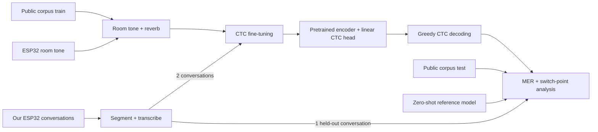

# CodeSwitch-ASR

**CTC fine-tuning of a pretrained speech encoder for Mandarin-English code-switched
conversation recorded on a low-cost microphone.**
COMP 395 (Deep Learning) final project, Occidental College, Fall 2026.

> Status: Week 1 -- project scaffold. Sections marked TODO are filled in as the project progresses.

## Project summary

TODO (final version after results). Working description: off-the-shelf ASR models often
fail on conversational speech that mixes Mandarin and English within a sentence, and they
do worse on audio from cheap microphones. We fine-tune a pretrained speech encoder
(wav2vec 2.0 family) with a CTC output layer on a public code-switching corpus (ASCEND is
the current candidate), add room noise and simulated reverberation to the training audio,
and test on the public test split and on our own conversations among international
students recorded with a low-cost ESP32 board. We also analyze whether errors concentrate
at the points where speakers switch languages.

## Research questions

1. How much does CTC fine-tuning reduce mixed error rate (MER), compared with an
   off-the-shelf zero-shot model?
2. Does noise augmentation (real room tone + simulated reverb) help on ESP32 audio?
3. Does a small amount of in-domain data (our recordings) help further?
4. Are errors concentrated where speakers switch between Mandarin and English?

## Codebase map

| Path | Purpose |
|---|---|
| `pyproject.toml`, `uv.lock` | Reproducible environment (uv) |
| `configs/` | One YAML file per experiment |
| `scripts/prepare_data.py` | Download the public corpus; prepare our recordings if present |
| `src/codeswitch_asr/data.py` | Common dataset format, text normalization, CTC vocabulary, conversation-level splits |
| `src/codeswitch_asr/augment.py` | Noise augmentation: room tone at a set SNR + simulated reverb (pyroomacoustics) |
| `src/codeswitch_asr/segment.py` | Align ESP32 and phone recordings; cut into utterances |
| `src/codeswitch_asr/transcribe.py` | Zero-shot reference model; draft transcripts for manual correction |
| `src/codeswitch_asr/finetune.py` | CTC fine-tuning (pretrained encoder + linear CTC head) with W&B logging |
| `src/codeswitch_asr/evaluate.py` | Greedy CTC decoding and MER |
| `src/codeswitch_asr/analysis.py` | Switch-point error rate; CTC frame-probability plots |
| `tests/` | Sanity tests |
| `docs/` | Project outline, recording protocol, architecture diagrams |
| `report/` | LaTeX report source (`.tex`) and compiled PDF |
| `logs/` | Exported training logs |
| `transcripts/` | AI conversation transcripts (course AI policy) |

## Architecture

TODO: replace with the final diagram stored in `docs/architecture/`.



## Setup & run

Requires [uv](https://docs.astral.sh/uv/). On Windows/Linux, uv installs the CUDA build of
PyTorch (an NVIDIA driver is required); on macOS it installs the default build (MPS).

```bash
uv sync                                                          # 1. build the environment
uv run python scripts/prepare_data.py --config configs/data.yaml # 2. download / prepare data
uv run python -m codeswitch_asr.finetune --config configs/ft_ascend.yaml  # 3. fine-tune
```

TODO: zero-shot and evaluation commands.

## Experiments

Each model changes one thing from the previous one. Every fine-tuned model starts from the
same pretrained encoder.

| Experiment | Training data | Config |
|---|---|---|
| Zero-shot reference | none (off-the-shelf ASR model) | `configs/eval_zeroshot.yaml` |
| A | public corpus (clean) | `configs/ft_ascend.yaml` |
| A-noise | public corpus + noise augmentation | `configs/ft_ascend_noise.yaml` |
| B | A-noise data + our 2 training conversations | `configs/ft_ascend_noise_ours.yaml` |

Test sets: the public test split and our held-out conversation (ESP32).
Metric: MER (character-level for Mandarin, word-level for English).

## Data & privacy

- The public corpus (ASCEND, CC BY-SA 4.0) is downloaded by `scripts/prepare_data.py`;
  it is not stored here.
- Our recordings are of real people and are **not** in this repository. They were made
  with participants' consent (see `docs/recording_protocol.md`). Without them, the
  public-corpus experiments still run.

## Results summary

TODO

## Training logs

TODO: W&B project link and exported logs in `logs/`.

## AI usage log

TODO: summarize how AI tools were used and what value they provided.
Transcripts are in `transcripts/`.

## Team

- Mia (Yuanrong) Shen
- Charlie Wu

## License

MIT for the code -- see `LICENSE`. Datasets keep their own licenses.

## References

- Lovenia et al., "ASCEND: A Spontaneous Chinese-English Dataset for Code-switching in
  Multi-turn Conversation," LREC 2022.
- Graves et al., "Connectionist Temporal Classification: Labelling Unsegmented Sequence
  Data with Recurrent Neural Networks," ICML 2006.
- Baevski et al., "wav2vec 2.0: A Framework for Self-Supervised Learning of Speech
  Representations," NeurIPS 2020.
